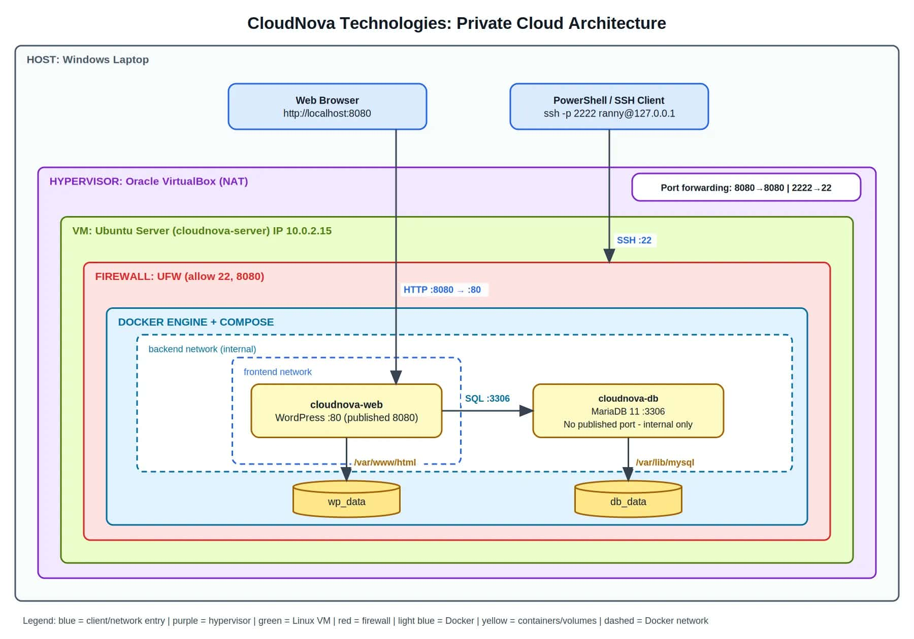

# Laboratory 10: Enterprise Cloud Architect

**Course:** CCM101 – Cloud Computing
**Project:** CloudNova Technologies Private Cloud
**Stack:** WordPress + MariaDB (Docker Compose)

## Overview
A secure, automated, multi-tier private cloud running on an Ubuntu Server VM. The web tier (WordPress) and the database tier (MariaDB) run as linked containers. Data lives in persistent named volumes, backups and health checks are automated with Bash and cron, and the VM is protected by a UFW firewall.

## Architecture


| Layer | Technology |
|---|---|
| Host | Windows laptop (browser + PowerShell/SSH client) |
| Hypervisor | Oracle VirtualBox, NAT with port forwarding |
| Guest OS | Ubuntu Server (`cloudnova-server`, 10.0.2.15) |
| Firewall | UFW (allow 22/tcp, 8080/tcp; deny all other incoming) |
| Containers | `cloudnova-web` (WordPress), `cloudnova-db` (MariaDB 11) |
| Storage | Named volumes `db_data`, `wp_data` |

**Port forwarding (VirtualBox):** host `2222` → guest `22` (SSH), host `8080` → guest `8080` (web).

## Why this stack
WordPress + MariaDB is a standard two-tier design: a stateless web tier and a stateful data tier. It is simple to explain, easy to test for persistence, and common in production.
[Add your own reason here.]

## Design decisions
- **Two Docker networks:** `frontend` (web only) and `backend` (web + DB). The DB is never attached to the frontend network.
- **DB has no published port**, so it is unreachable from outside Docker.
- **Secrets in `.env`** (permission 600, excluded from Git). `.env.example` shows the required keys.
- **Healthcheck + `depends_on: service_healthy`** so WordPress starts only when MariaDB is ready.
- **`restart: unless-stopped`** plus `systemctl enable docker` brings the stack back after a reboot.

## Repository contents
| File | Purpose |
|---|---|
| `architecture-diagram.png` | Network topology and architecture diagram (editable source: `.drawio`) |
| `docker-compose.yml` | Infrastructure as Code for the stack |
| `.env.example` | Template for credentials (real `.env` is not committed) |
| `automation-script.sh` | Backup, restore, health check, and self-healing |
| `operational-manual.md` | Step-by-step runbook |
| `final-reflection.md` | Personal reflection |

## Quick deploy
```bash
cd ~/cloudnova-stack
cp .env.example .env && chmod 600 .env   # then edit with real passwords
docker compose config
docker compose up -d
docker compose ps
```
Open `http://localhost:8080` on the host.

## Evidence (screenshots)
Add screenshots to a `screenshots/` folder and link them here:
- [ ] `docker --version` and `docker compose version`
- [ ] `docker compose ps` (both containers up, DB healthy)
- [ ] WordPress site in the host browser
- [ ] Test post surviving `docker compose down` / `up -d`
- [ ] Test post surviving a VM reboot
- [ ] `sudo ufw status verbose`
- [ ] Backup files in `~/cloudnova-backups`
- [ ] Self-healing test log
- [ ] `crontab -l`

